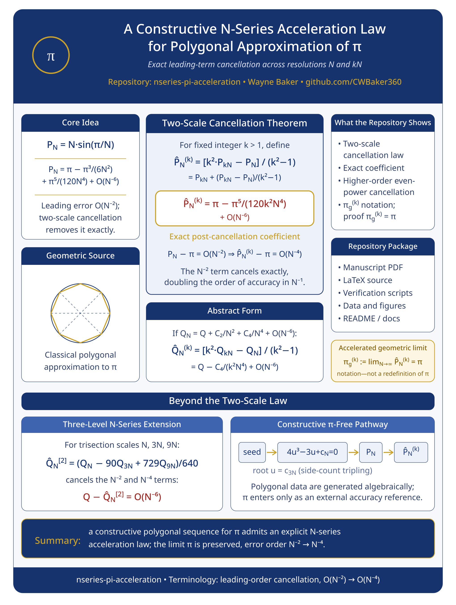

<p align="center">
  
</p>

# Certified Constructive N-Series Acceleration for Polygonal Approximation of π

**Author:** Wayne Baker  
**Manuscript revision:** November 15, 2026  
**Status:** Preprint / source and reproducibility archive

This repository contains the paper, LaTeX source, and supporting Python scripts for:

> **Certified Constructive N-Series Acceleration for Polygonal Approximation of π**

## Read the paper

- [Read the paper (PDF)](paper/nseries_pi_acceleration.pdf)
- [LaTeX source](paper/nseries_pi_acceleration.tex)
- [Historical GitHub releases (may contain older manuscript)](https://github.com/CWBaker360/N-Series-pi-acceleration/releases)

## Lean 4 formal verification

The mathematical core has a [separate Lean 4/Mathlib companion repository](https://github.com/CWBaker360/nseries-lean-verification). Its pinned A–E10 development reports a successful 28-module build and a 112-declaration axiom audit (standard axioms only; no reported `sorryAx`). A later seven-module constructible-ladder checkpoint and Proposition 4.6 have **separate** local verification evidence and must not be conflated with that earlier audit.

See [verification scope, pinned source, and evidence links](verification/README.md). The PDF and TeX in `paper/` are the November 15 manuscript revision, with its publication-provenance clarifications. The [frozen constructible ladder](verification/constructible-ladder-2026-11-15/) and [independently reproduced exact-rational Richardson certificate](verification/certified_richardson_v3_0/) are published separately. No GitHub release or new Zenodo deposit accompanies this main-branch documentation update.

## Main result

For the polygonal half-perimeter sequence

$$
P_N
=
N\sin\!\left(\frac{\pi}{N}\right),
$$

the symmetry-induced error expansion contains only even powers of $N^{-1}$:

$$
P_N
=
\pi
-
\frac{\pi^3}{6N^2}
+
\frac{\pi^5}{120N^4}
-
\frac{\pi^7}{5040N^6}
+
O(N^{-8}).
$$

For any fixed integer $k>1$, define

$$
\widehat P_N^{(k)}
=
P_{kN}
+
\frac{P_{kN}-P_N}{k^2-1}.
$$

Then

$$
\widehat P_N^{(k)}
=
\pi+O(N^{-4}).
$$

More generally, weighted multiscale operators cancel successive even-power
terms through a Vandermonde moment system.

## π-free computational lane

The repository scripts generate polygonal approximants algebraically from chord
half-lengths. The side count is tripled by solving

$$
4u^3-3u+c_N=0,
\qquad
u=c_{3N},
$$

and the scale-$3$ N-series tableau accelerates the resulting half-perimeter
sequence. The value of $\pi$ is used only afterward to count verified digits.

## Scripts

### `baker_chord_nseries.py`

Configurable verification script with:

- triangle or hexagon algebraic seed;
- scale-$3$ N-series acceleration;
- optional cubic residual and derivative root-error certificate;
- configurable target precision and output directory.

### `baker_pi_target.py`

Resumable large-target production script with:

- automatic precision and level sizing;
- atomic checkpointing;
- triangle-seeded chord-trisection ladder;
- high-digit output generation.

## Scope

The paper does not redefine $\pi$. The accelerated sequence has the same
Archimedean limit and changes only the finite-resolution error structure.

The two-scale operator and polygonal even-power expansion are classical Richardson-type material. The contributions examined in the revised paper include the algebraic branch identification, constructive residual inheritance and target-dependent refinement budget, an exact-rational finite-value certificate, and their carefully delimited Lean formalizations.

## Research triad

This paper is the third work in a three-paper research sequence:

1. [A Constructible Cubic Error Cascade for Approximate Angle Trisection](https://github.com/CWBaker360/Constructible-Cubic-Trisection/releases/latest)
2. [A Local Cubic Refinement Law for Proportional-Subtended Angle Division](https://github.com/CWBaker360/proportional-subtended-cubic-refinement/releases/latest)
3. [Certified Constructive N-Series Acceleration for Polygonal Approximation of π](paper/nseries_pi_acceleration.pdf)

Together, the three papers develop the progression

**constructible approximation → local cubic refinement → higher-order acceleration**.

The first paper presents a specific constructible approximation and its cubic
error cascade. The second derives the general proportional-subtended
cancellation law and proves the uniqueness of the scaling that removes the
linear residual term. The third applies structured asymptotic cancellation to
accelerate polygonal approximations of π.

## Repository structure

```text
.
├── README.md
├── CITATION.cff
├── REPRODUCIBILITY.md
├── LICENSE
├── LICENSE-PAPER.md
├── LICENSE_NOTICE.md
├── CHANGELOG.md
├── SHA256SUMS.txt
├── .gitignore
├── paper/
│   ├── nseries_pi_acceleration.tex
│   ├── nseries_pi_acceleration.pdf
│   └── README.md
├── scripts/
│   ├── baker_chord_nseries.py
│   ├── baker_pi_target.py
│   └── README.md
├── verification/
│   ├── constructible-ladder-2026-11-15/
│   └── certified_richardson_v3_0/
└── docs/
    ├── abstract.md
    ├── repository_description.md
    └── github_upload_checklist.md
```

## Licensing

This repository uses a dual-license structure:

- The manuscript text, LaTeX manuscript source, compiled PDF, figures,
  documentation, and supporting written research materials are licensed under
  the **Creative Commons Attribution 4.0 International License (CC BY 4.0)**.
  See [`LICENSE-PAPER.md`](LICENSE-PAPER.md).

- Executable source code, scripts, and software utilities are licensed under
  the **MIT License**. See [`LICENSE`](LICENSE).

The LaTeX manuscript source is treated as research and publication material
and is therefore licensed under CC BY 4.0.

For the detailed scope of each license, see
[`LICENSE_NOTICE.md`](LICENSE_NOTICE.md).

Copyright © 2026 Wayne Baker.
